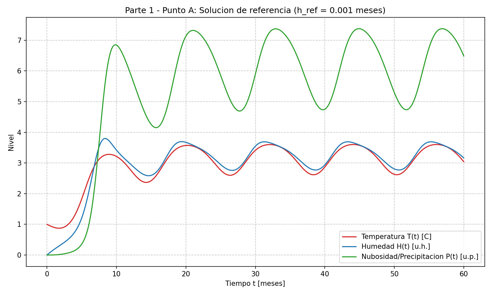
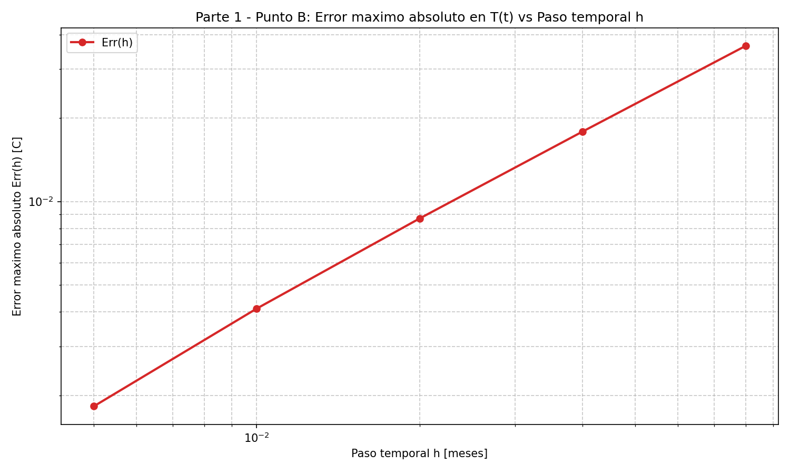
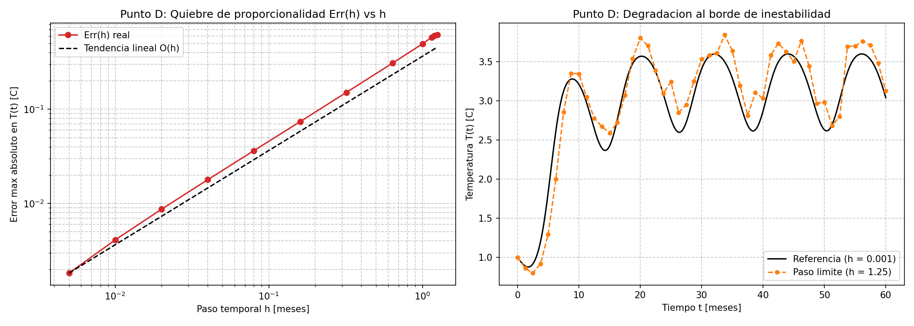
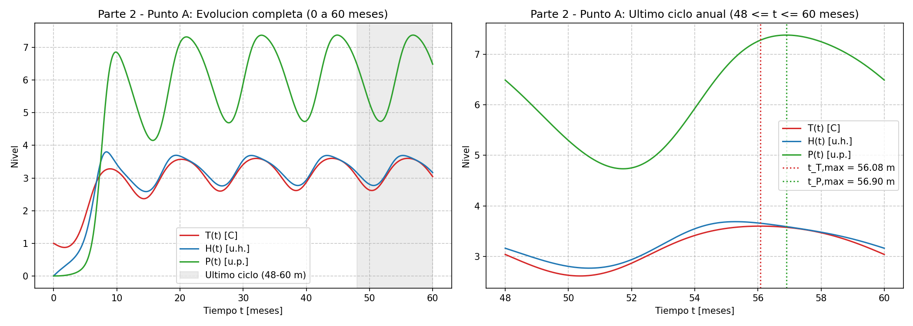
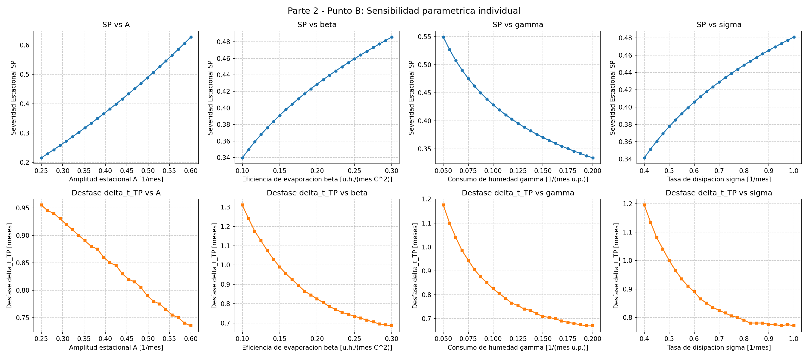
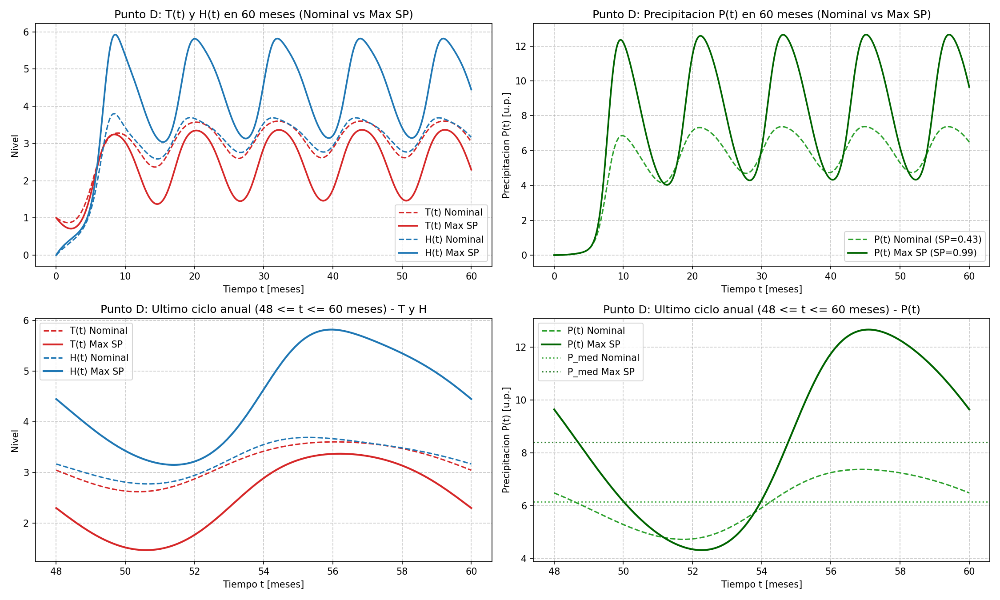

# FACULTAD DE INGENIERÍA
**Universidad de Buenos Aires**

 

## “ANÁLISIS NUMÉRICO I”
## “MODELACIÓN NUMÉRICA”
**<75.12> <95.04> <95.13>**

 

### DATOS DEL TRABAJO PRÁCTICO

| TP NRO | AÑO | CUAT | TEMA |
| :---: | :---: | :---: | :--- |
| Único | 2026 | 2do | Problema de valores iniciales no lineal - Modelo simplificado del fenómeno de El Niño |

 

### INTEGRANTES DEL GRUPO

| GRUPO | APELLIDO Y NOMBRE | PADRÓN |
| :---: | :--- | :---: |
| - | Hahn, Guillermo Santiago | 112761 |
| - | [Nombre y Apellido del Compañero] | [Padrón] |

 

## Desarrollo del Trabajo Práctico

### Parte 1: Convergencia, orden y estabilidad del método de Euler

#### Punto 1.A: Solución de Referencia
Se obtuvo una solución de referencia utilizando el método de Euler con un paso temporal muy pequeño ($h_{ref} = 0.001$ meses) para minimizar el error de truncamiento frente a las discretizaciones posteriores.

#### Punto 1.B y 1.C: Relación Error vs Paso y Orden Observado
Al resolver el problema utilizando una sucesión de pasos $h$ y duplicándolos progresivamente, cuantificamos el error mediante el máximo error absoluto sobre el intervalo de la variable $T(t)$.

Al desarrollar en serie de Taylor la solución exacta, el método de Euler explícito comete un error de truncamiento global acumulado sobre todo el intervalo proporcional a $h$, es decir, $\text{Err}(h) \approx C \cdot h^1$. Por ello, al duplicar el paso temporal en el régimen convergente, el cociente $\text{Err}(2h)/\text{Err}(h) \approx 2$ arroja experimentalmente un orden $p = \log_2(\text{Err}(2h)/\text{Err}(h)) \approx 1.00$. En el gráfico log-log, esto se verifica como una recta de pendiente unitaria.

#### Punto 1.D: Error de discretización e Inestabilidad numérica
Continuamos aumentando el paso temporal para analizar el punto de quiebre del método.

*   **Error de discretización (o truncamiento):** Proviene de reemplazar la derivada continua por el cociente incremental finito. Cuando el método es estable, este error crece de manera suave y predecible proporcional a $h$, deformando la amplitud y fase de las curvas pero conservando la naturaleza acotada de la solución física.
*   **Inestabilidad numérica:** Ocurre cuando el paso $h$ supera el umbral de estabilidad absoluta del método explícito de Euler. Al acercarse a $h \approx 1.20 - 1.25$ meses, el factor de amplificación excede la unidad en ciertas fases del ciclo, introduciendo oscilaciones espurias que hacen que el error se despegue abruptamente de la tendencia lineal. Para $h \ge 1.30$ meses, los errores se amplifican exponencialmente paso a paso hasta producir un desbordamiento numérico (overflow), destruyendo por completo la solución.

---

### Parte 2: Severidad estacional, desfase y sensibilidad paramétrica

Para esta sección, adoptamos un paso de integración $h = 0.005$ meses porque garantiza un error de truncamiento mínimo y captura la dinámica sin escalonamientos temporales para el cálculo de indicadores. Los cálculos se realizan exclusivamente sobre el último ciclo anual ($48 \le t \le 60$ meses) para asegurar la disipación del régimen transitorio.

#### Punto 2.A: Severidad estacional y desfase (Caso Nominal)

Evaluando el sistema con los parámetros nominales, observamos una severidad estacional base de $SP \approx 0.4288$. Existe una clara inercia en el sistema acoplado: el pico de precipitación ocurre aproximadamente $0.825$ meses después del pico térmico oceánico.

#### Punto 2.B: Sensibilidad paramétrica individual

Al aislar cada parámetro, las ecuaciones diferenciales explican las tendencias obtenidas:
1.  **Amplitud de modulación ($A$):** Aumentar $A$ exacerba tanto el calentamiento estival como el enfriamiento invernal. Esta mayor amplitud térmica se propaga de forma no lineal, elevando drásticamente el contraste estacional $SP$ (subiendo por encima de 0.60) y reduciendo levemente el desfase $\Delta t_{TP}$.
2.  **Eficiencia de evaporación ($\beta$):** Interviene en la generación de humedad ($+\beta T^2$). Un $\beta$ mayor hace que la atmósfera se sature más rápido ante un mismo aumento de temperatura, provocando que el desfase $\Delta t_{TP}$ caiga significativamente.
3.  **Consumo de humedad ($\gamma$):** Funciona como un sumidero no lineal ($-\gamma H P$). Si aumenta, la presencia de precipitación agota velozmente la humedad disponible, acortando la duración del evento de lluvia y disminuyendo el $\Delta t_{TP}$.
4.  **Tasa de disipación ($\sigma$):** Define la velocidad de descarga continental ($-\sigma P$). Un $\sigma$ alto permite que el sistema se "seque" casi por completo en la estación fría, bajando notablemente $P_{min}$ e incrementando la severidad $SP$.

#### Puntos 2.C y 2.D: Búsqueda de máxima severidad vs. Saturación de parámetros

Mediante una búsqueda en grilla, determinamos que **el escenario de mayor severidad NO corresponde a fijar todos los parámetros en su valor máximo**. 

La máxima severidad ocurre con el forzamiento ($A=0.60$), la evaporación ($\beta=0.30$) y la disipación ($\sigma=1.00$) en sus topes, pero requiere que el consumo de humedad esté en su valor **mínimo** ($\gamma=0.05$). 

**Justificación:** Si maximizáramos todos los parámetros simultáneamente (incluyendo $\gamma=0.20$), el término negativo $-\gamma H P$ de la segunda ecuación se volvería tan agresivo que frenaría la acumulación de humedad. La atmósfera se descargaría antes de acumular suficiente agua, aplastando el pico de lluvia y dando un $SP$ bajo. En cambio, al mantener $\gamma$ al mínimo, permitimos que la eficiencia $\beta$ acumule masivamente la humedad ($H$) sin consumirla prematuramente. Esto termina disparando cuadráticamente el término $\delta H^2$ de la tercera ecuación, generando un pico de precipitación violento seguido de un vaciado rápido.

---

## Uso de herramientas de Inteligencia Artificial

Durante el desarrollo de este trabajo práctico, utilizamos Inteligencia Artificial (Gemini) como asistente de programación y redacción. Queremos aclarar que **el planteo físico, las condiciones iniciales y la lógica algorítmica base fueron desarrollados por el equipo**. Sin embargo, nos apoyamos en la IA para optimizar cuestiones específicas de implementación y presentación:

*   **Definición y consistencia de variables:** Nos ayudó a detectar y corregir inconsistencias rápidas en la nomenclatura matemática de nuestro código (por ejemplo, un coeficiente que teníamos mal nombrado como `SIGMA` y que corregimos a `TITA` para seguir la convención correcta).
*   **Construcción de las Ecuaciones Diferenciales:** En un principio, habíamos planteado tres funciones distintas para calcular cada delta por separado. La IA nos sugirió unificar el cálculo en una única función que devuelva los tres resultados simultáneamente. Nos pareció una solución mucho más limpia, eficiente y práctica a nivel de código, por lo que adoptamos esa estructura.
*   **Optimización del método de Euler:** Nos recomendó utilizar arreglos de `numpy` en lugar de las listas nativas de Python para la evolución temporal. Como vimos en materias anteriores (como Fundamentos de la Programación), Numpy maneja las operaciones vectoriales en C por detrás, lo que hace que las iteraciones en una simulación de este tamaño sean muchísimo más rápidas.
*   **Generación de gráficos (Layout):** Utilizamos la herramienta para que nos asista en el armado del *layout* de los gráficos con `matplotlib` (creación de subplots, configuración de escalas logarítmicas, leyendas y grillas). Pasar los datos de Numpy directamente a estas funciones es el estándar de la industria y el asistente nos ahorró mucho tiempo de formato visual.
*   **Redacción y corrección de estilo:** Finalmente, nos apoyamos en el asistente para revisar y pulir la redacción de nuestro borrador para este informe, asegurando que el texto fluya bien y que las justificaciones físicas queden claras para su lectura.
